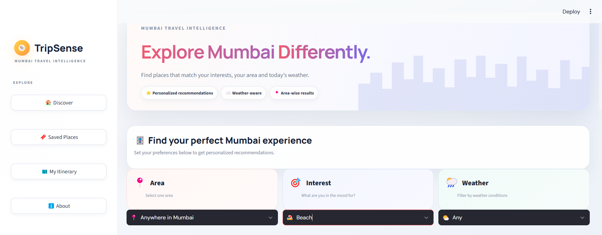
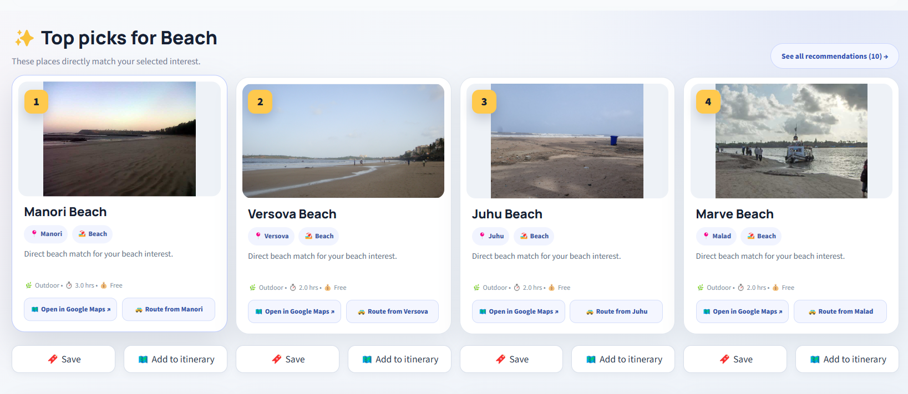
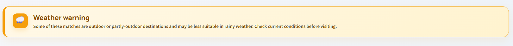
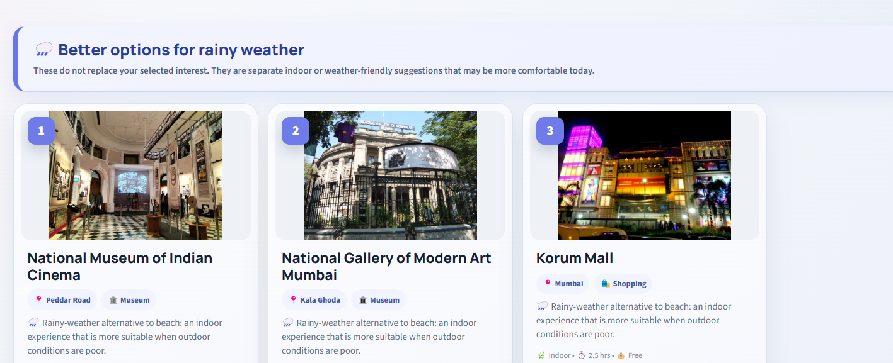
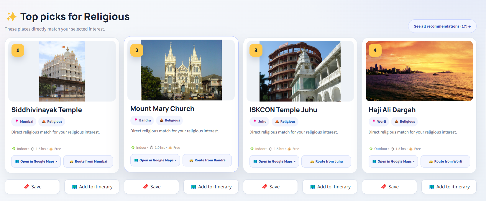

# TripSense — Smart Travel Recommendation System for Mumbai

**Explore Mumbai differently with personalized, semantic, and weather-aware travel recommendations.**

## Overview

TripSense is a Python-based travel recommendation web application that helps users discover places in Mumbai based on their interests, preferred area, and selected weather conditions. It uses semantic text embeddings, cosine similarity, and rule-based weather adjustments to rank suitable destinations.

## Key Features

- **Personalized Recommendations:** Suggests destinations based on user interests.
- **Area-Based Filtering:** Helps users explore places across different areas of Mumbai.
- **Semantic Similarity:** Matches user preferences with destination descriptions using Sentence Transformers.
- **Weather-Aware Ranking:** Adjusts recommendations based on the selected weather condition.
- **Weather Warnings:** Highlights potentially unsuitable outdoor destinations.
- **Indoor Alternatives:** Helps users discover indoor places during rainy weather.
- **Religious Place Discovery:** Supports exploring temples and religious attractions.
- **Interactive Interface:** Provides an easy-to-use Streamlit web application.

## Technology Stack

| Technology | Purpose |
|---|---|
| Python | Core application and recommendation logic |
| Streamlit | Interactive web interface |
| Sentence Transformers | Text embedding generation |
| `all-MiniLM-L6-v2` | Semantic embedding model |
| Cosine Similarity | Measures similarity between user preferences and places |
| Pandas and NumPy | Data processing and numerical operations, where used |
| CSV | Structured destination dataset |
| Git and GitHub | Version control and source code hosting |
| Streamlit Community Cloud | Application deployment |

## How It Works

1. **User Input:** The user selects an area, interests, and weather conditions.
2. **Dataset Processing:** The application retrieves destination information from the Mumbai places dataset.
3. **Semantic Embeddings:** The Sentence Transformer model converts text into numerical vectors.
4. **Similarity Calculation:** Cosine similarity measures how closely each destination matches the user's preferences.
5. **Weather-Aware Ranking:** Predefined weather rules adjust recommendation scores.
6. **Recommendation Display:** The application displays ranked destinations through Streamlit.

## Recommendation Methodology

TripSense uses a content-based recommendation approach. It compares user preferences with the descriptions of destinations rather than relying only on exact keyword matches.

The cosine similarity between two vectors is calculated as:

\[
\operatorname{sim}(A,B)=
\frac{A\cdot B}{\|A\|\|B\|}
\]

A higher similarity score generally indicates a stronger semantic match.

The weather-aware component applies predefined adjustment factors to influence the ranking. The current version uses user-selected weather conditions rather than automatically retrieving live weather data.

## Project Structure

```text
TripSense/
├── app.py
├── recommender.py
├── requirements.txt
├── README.md
├── docs/
│   └── screenshots/
│       ├── homepage.png
│       ├── beach-recommendations.png
│       ├── weather-warning.png
│       ├── rainy-weather-alternatives.png
│       └── religious-recommendations.png
└── data/
    ├── mumbai_places.csv
    └── place_embeddings.npy
```

*This is an illustrative structure. Your actual repository may contain additional files or use different filenames.*

## Installation and Setup

### Prerequisites

- Python installed on your computer
- Git installed on your computer

### 1. Clone the Repository

```bash
git clone https://github.com/PratikBhoir10/TripSense.git
cd TripSense
```

### 2. Create and Activate a Virtual Environment

**Windows PowerShell:**

```powershell
python -m venv venv
.\venv\Scripts\Activate.ps1
```

### 3. Install Dependencies

```bash
pip install -r requirements.txt
```

### 4. Run the Application

```bash
streamlit run app.py
```

Open the local URL provided by Streamlit in your browser.

## Deployment

TripSense can be deployed using [Streamlit Community Cloud](https://share.streamlit.io/).

1. Push the required project files to GitHub.
2. Connect your GitHub account to Streamlit Community Cloud.
3. Select the TripSense repository and the `main` branch.
4. Set the main file path to `app.py`, if that is your actual entry point.
5. Deploy the application.

Ensure that all required datasets, embedding files, and dependencies are included and accessible at the expected paths.

**Live Demo:**(https://tripsense-mheekab95pdrrcqwqbtgfp.streamlit.app/)

## Limitations and Future Scope

### Current Limitations

- Recommendations depend on the quality and completeness of the dataset.
- Weather conditions are selected manually.
- Weather adjustments use predefined rules.
- Similarity scores indicate textual relevance, not guaranteed user satisfaction.

### Future Enhancements

- Integrate a live weather API.
- Add interactive maps and route planning.
- Include verified opening hours and entry fees.
- Incorporate user ratings and feedback.
- Expand the destination dataset and improve personalization.

## Author

**Pratik Bhoir**  
B.Tech — Electronics and Computer Science  
Vidyalankar Institute of Technology, Mumbai

GitHub: [PratikBhoir10](https://github.com/PratikBhoir10)

---

*TripSense — Making travel discovery in Mumbai smarter and more personalized.*


## Application Screenshots

### 1. TripSense Home Page

Explore Mumbai with personalized recommendations, area filters, and weather preferences.



### 2. Beach Recommendations

Discover beaches ranked according to your selected interests.



### 3. Weather-Aware Recommendations

View weather warnings for outdoor destinations.



### 4. Rainy Weather Alternatives

Find indoor attractions that may be more suitable during rainy conditions.



### 5. Religious Place Recommendations

Discover temples and religious attractions across Mumbai.


